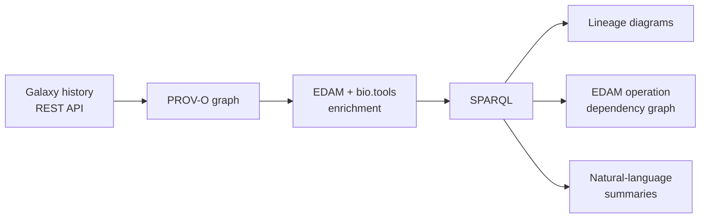

# Galaxy-PROV notebook: semantic provenance graphs from Galaxy histories

[](LICENSE.txt)
[](https://www.python.org/)
[](https://www.w3.org/TR/prov-o/)
[](https://edamontology.org)

Turn [Galaxy](https://galaxyproject.org) histories into **FAIR provenance knowledge graphs**. The graphs use W3C [PROV-O](https://www.w3.org/TR/prov-o/) and are enriched with [EDAM](https://edamontology.org) terms and [bio.tools](https://bio.tools) identifiers. You can then query, summarise and describe them in plain language with SPARQL.

---

## Overview

[Galaxy](https://galaxyproject.org) is an open, web-based platform that lets life scientists run bioinformatics tools and workflows without programming. It is used on thousands of servers worldwide, including public instances such as usegalaxy.eu.

In Galaxy, all the work of an analysis lives in a **history**: an ordered record of the datasets uploaded or produced, the tools and versions run, their parameters and the command lines executed. Histories can be shared or published.

Galaxy stores this provenance in its own internal model, reachable only through its REST API. Without a standard vocabulary such as W3C PROV, or shared semantics for tools and data types such as EDAM, Galaxy traces are hard to:

- combine with provenance from other workflow systems (Nextflow, Snakemake, CWL);
- query across instances;
- reuse to assess the reproducibility and FAIRness of an analysis.

The [`notebooks/Galaxy-PROV.ipynb`](notebooks/Galaxy-PROV.ipynb) notebook fills this gap with the pipeline below:



## Features

- **Harvest** the published histories of any Galaxy instance through its REST API (default: [usegalaxy.eu](https://usegalaxy.eu)).
- **Model provenance with PROV-O**:
  - datasets as `prov:Entity`
  - jobs as `prov:Activity`
  - tools as `prov:Agent`
  - timestamps and command lines on each job
- **Enrich semantically**:
  - EDAM formats and data types on datasets;
  - EDAM operations and topics on tools;
  - `owl:sameAs` links from tools to bio.tools.
- **Visualise** dataset lineage and how tools and data connect, with Graphviz.
- **Abstract** a concrete run into a dependency graph of EDAM operations, using a SPARQL `CONSTRUCT` query.
- **Verbalise** each processing step as natural-language text, for methods sections, reports or LLM grounding.
- **Export** everything as standard RDF (Turtle), ready for any triple store.

## Getting started

### Prerequisites

- Python ≥ 3.10 (tested with 3.12)
- [Graphviz](https://graphviz.org/download/), the system library required by `pygraphviz` (tested with 12.2)
- A Galaxy account and API key. You only need these to generate new graphs; the included `.ttl` files work without them.

### Installation

```bash
git clone https://github.com/albangaignard/galaxy-PROV.git
cd galaxy-PROV/notebooks

# Graphviz system library
brew install graphviz                          # macOS
# sudo apt install graphviz libgraphviz-dev    # Debian / Ubuntu

# Python environment
python -m venv .venv && source .venv/bin/activate
pip install -r requirements.txt
```

Using conda instead of pip: 
```bash
conda create -n galaxy-prov -c conda-forge python=3.12 pygraphviz rdflib requests tqdm ipywidgets jupyterlab
conda activate galaxy-prov
```

### Configuration

1. Create an API key in Galaxy: *User → Preferences → Manage API Key*.
2. Export it before starting Jupyter:

```bash
export GALAXY_API_KEY=<your-api-key>
```

To use another Galaxy instance, change `galaxy_url` in section 1 of the notebook.

### Usage

From the `notebooks/` folder:

```bash
jupyter lab Galaxy-PROV.ipynb
```

Then run the sections in order:

| Section | What it does |
|---|---|
| 1. Setup | Imports, Galaxy URL, API key |
| 2. Galaxy API helpers | Lists histories and fetches datatype → EDAM mappings |
| 3. PROV-O modelling | Defines `gen_prov_graph(url, key, history_id)` |
| 4. Selecting a history | Lists recently updated published histories |
| 5. Generating the graph | Builds the graph and saves it as Turtle |
| 6. Loading EDAM | Adds EDAM labels to the graph |
| 7. Visualising provenance | Dataset lineage, and how tools and data connect |
| 8. EDAM operation dependency graph | Abstract view of the workflow |
| 9. Verbalisation | Plain-language description of every step |

To process your own history, set `history_id` in section 5 to any ID listed in section 4.

**Without an API key**, run section 1, load a pre-computed graph, then run sections 6–9:

```python
graph = Dataset()
graph.parse("MetaG_extended.ttl", format="turtle")
```

## Example data

The paper uses these public usegalaxy.eu histories:

| Example | Galaxy history ID | Provenance graph |
|---|---|---|
| Metagenomics | `e42801c065f09977` | [`MetaG_extended.ttl`](notebooks/MetaG_extended.ttl) |
| RNA-seq | `11ac94870d0bb33a534996fe140ec000` | [`wf-rna_seq-2026.ttl`](notebooks/wf-rna_seq-2026.ttl) |
| antagomiR lab session | `11ac94870d0bb33a76b5f0b7b347b500` | [`Labaratorinis_1_antagomiR.ttl`](notebooks/Labaratorinis_1_antagomiR.ttl) |

## Outputs

| File | Description |
|---|---|
| `<history>.ttl` | PROV-O provenance graph enriched with EDAM and bio.tools |
| `operations_dependency_graph.ttl` | EDAM operation dependency graph (RDF) |
| `operations_dependency_graph.pdf` | Diagram of the dependency graph |

The lineage diagrams and the text summaries are shown directly in the notebook.

## Data model

| Galaxy concept | RDF modelling |
|---|---|
| Dataset | `prov:Entity`, `rdfs:label`, `rdfs:seeAlso`, `edam:has_format`, `edam:has_data` |
| Job | `prov:Activity`, `prov:startedAtTime`, `prov:endedAtTime`, `prov:value` (command line) |
| Tool | `prov:Agent`, `rdfs:label`, `edam:has_operation`, `edam:has_topic`, `owl:sameAs` → bio.tools |
| Relations | `prov:used`, `prov:wasGeneratedBy`, `prov:wasDerivedFrom`, `prov:wasAssociatedWith`, `prov:wasAttributedTo` |

URIs follow the Galaxy API endpoints, for example `https://usegalaxy.eu/api/jobs/<id>`, so graphs from different instances can be merged safely.

Example query, listing each processing step with its tool, EDAM operation and bio.tools identifier:

```sparql
PREFIX prov: <http://www.w3.org/ns/prov#>
PREFIX rdfs: <http://www.w3.org/2000/01/rdf-schema#>
PREFIX owl:  <http://www.w3.org/2002/07/owl#>

SELECT ?input_label ?tool_label ?edam_op ?bio_tools_id ?output_label WHERE {
  ?output prov:wasGeneratedBy ?activity ; rdfs:label ?output_label .
  ?activity prov:used ?input ; prov:wasAssociatedWith ?tool .
  ?input rdfs:label ?input_label .
  OPTIONAL { ?tool rdfs:label ?tool_label }
  OPTIONAL { ?tool <http://edamontology.org/has_operation> ?edam_op }
  OPTIONAL { ?tool owl:sameAs ?bio_tools_id }
}
```

## Repository structure

```text
.
├── README.md
├── LICENSE.txt
├── Dockerfile                        # Legacy: Docker image for the Java CLI
├── galaxy-PROV/                      # Legacy Java/Maven implementation
└── notebooks/
    ├── Galaxy-PROV.ipynb                 # Main companion notebook
    ├── Galaxy-PROV-EDAM.ipynb            # Exploratory: retrieval-based bio.tools / EDAM linking
    ├── requirements.txt                  # Python dependencies
    ├── EDAM_1.25.ttl                     # EDAM ontology (v1.25)
    ├── bioschemas-dump.ttl               # bio.tools Bioschemas dump (EDAM notebook)
    ├── *.ttl                             # Example provenance graphs
    └── operations_dependency_graph.*     # Example EDAM operation dependency graph
```

## Limitations

- **Tools without annotations.** EDAM operations and bio.tools links only appear when the Galaxy tool wrapper declares them. The exploratory [`notebooks/Galaxy-PROV-EDAM.ipynb`](notebooks/Galaxy-PROV-EDAM.ipynb) notebook suggests missing links with embedding-based retrieval.
- **Collections and uploads.** Items without job provenance, such as dataset collections and uploads, are skipped and logged as warnings.
- **Long runs.** Generating a graph makes several API calls per history item, so large histories can take minutes.


## Contributing and reporting issues

Contributions and feedback are welcome.

- **Bugs and questions:** open an issue on [GitHub](https://github.com/albangaignard/galaxy-PROV/issues), or email the maintainer (see [Contact](#contact)).
- **Pull requests:** fork the repository, create a feature branch and open a pull request with a short description of the change.
- When reporting a problem, please include:
  - the Galaxy instance;
  - the history ID, if it is public;
  - your Python and package versions;
  - the full error message.

## License

Distributed under the MIT License. See [`LICENSE.txt`](LICENSE.txt).

## Contact

**Alban Gaignard** (CNRS), [alban.gaignard@univ-nantes.fr](mailto:alban.gaignard@univ-nantes.fr)

Feel free to get in touch to report issues or ask questions about this notebook.

## Acknowledgements

- [Galaxy Europe](https://usegalaxy.eu), for the public API and histories
- [EDAM](https://edamontology.org) and [bio.tools](https://bio.tools)
- [RDFLib](https://github.com/RDFLib/rdflib) and [Graphviz](https://graphviz.org)

